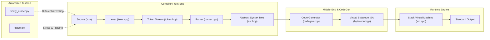

# C-Subset Mini-Compiler & Automated Verification Testbed

[](https://isocpp.org/)
[](https://python.org)
[](https://cmake.org)
[](LICENSE)

A production-grade, self-contained mini-compiler and virtual execution engine with an automated differential verification framework, engineered in Modern C++17 and Python 3.

Tailored for engineers targeting **NVIDIA System Software Engineering** roles (specifically the **PTX Compiler Front-End/Middle-End** and **Compiler Verification** teams).

---

## 📑 Table of Contents

- [Architectural Overview](#architectural-overview)
- [Pipeline Architecture Diagram](#pipeline-architecture-diagram)
- [Directory Structure](#directory-structure)
- [Language Specification](#language-specification)
- [Virtual Instruction Set Architecture (ISA)](#virtual-instruction-set-architecture-isa)
- [Quick Run Guide (Instant Verification)](#quick-run-guide-instant-verification)
- [Quick Start & Build Instructions](#quick-start--build-instructions)
  - [Windows (PowerShell / MSVC / MinGW)](#windows-powershell--msvc--mingw)
  - [Linux / macOS (Bash / Clang / GCC)](#linux--macos-bash--clang--gcc)
  - [Direct Compilation via g++](#direct-compilation-via-g)
- [CLI Driver Usage & Inspection Flags](#cli-driver-usage--inspection-flags)
- [Automated Verification & Fuzzing Harness](#automated-verification--fuzzing-harness)
- [Architecture & Design Decisions](#architecture--design-decisions)

---

## 🏛 Architectural Overview

The compiler is organized into a modular pipeline with clean separation of concerns:

```
+-------------+      +-------------+      +---------------+      +-------------------+      +-------------------+
| Source Code | ---> |    Lexer    | ---> | Recursive-    | ---> |  Code Generator   | ---> |   Virtual Machine |
| (.cm file)  |      | Token Stream|      | Descent Parser|      |  Bytecode IR (ISA)|      |   Stack Execution |
+-------------+      +-------------+      +---------------+      +-------------------+      +-------------------+
                            |                     |                        |                          |
                     Line/Col Tracking     Unique Ownership        Back-patching Jumps         Operand Stack
                     Comment Stripping     AST Pretty-Print        PTX-like Linear IR          Zero-Div Detection
```

### Pipeline Architecture Diagram



---

## 📂 Directory Structure

```
ptx-lite-compiler/
├── mini_compiler/
│   ├── include/
│   │   ├── token.hpp          # Lexical tokens, classifications, and line/col tracking
│   │   ├── lexer.hpp          # Lexer interface and LexerError exceptions
│   │   ├── ast.hpp            # Smart-pointer owned AST nodes with pretty-printing
│   │   ├── parser.hpp         # Recursive-descent parser with precedence climbing
│   │   ├── bytecode.hpp       # Virtual ISA opcodes, instruction struct, and disassembler
│   │   ├── codegen.hpp        # AST visitor & bytecode emitter with jump back-patching
│   │   └── vm.hpp             # Stack-based runtime VM engine interface
│   └── src/
│       ├── lexer.cpp          # Lexer implementation (comments, literals, ops)
│       ├── parser.cpp         # Parser implementation (Pratt precedence hierarchy)
│       ├── codegen.cpp        # AST traversal to bytecode generation
│       ├── vm.cpp             # VM runtime: operand stack, variables, bounds checking
│       └── main.cpp           # CLI entry point supporting pipeline inspection flags
├── tests/
│   ├── test_programs/         # Positive end-to-end verification programs
│   │   ├── 01_arithmetic.cm   # Operator precedence, associativity, unary ops
│   │   ├── 02_variables.cm    # Variable declarations, reassignments, mutations
│   │   ├── 03_control_flow.cm # Nested if-else conditionals and boolean logic
│   │   ├── 04_while_loop.cm   # Loop iterations, termination, and accumulator
│   │   └── 05_complex_math.cm # Iterative factorial (5!) and Fibonacci (F10)
│   └── error_cases/           # Negative verification suite for syntax diagnostics
│       ├── err_syntax_semicolon.cm # Missing delimiter diagnosis
│       ├── err_unclosed_paren.cm   # Unmatched grouping parenthesis
│       └── err_undeclared_var.cm   # Runtime undeclared variable access detection
├── verification/
│   ├── verify_runner.py       # Automated regression test harness & report generator
│   ├── fuzzer.py              # Differential synthetic program generator
│   └── requirements.txt       # Verification environment requirements
├── CMakeLists.txt             # Cross-platform CMake build definition (C++17)
├── build.ps1                  # Windows PowerShell automated build & test script
├── build.sh                   # Unix/macOS automated build & test script
└── README.md                  # System architecture documentation
```

---

## 📜 Language Specification

The mini-language (file extension `.cm`) is a clean subset of C:

- **Types**: 32-bit signed integers (`int`).
- **Statements**:
  - Variable declarations: `int x = 10;`
  - Re-assignments: `x = x + 5;`
  - Conditionals: `if (expr) { ... } else { ... }`
  - Loops: `while (expr) { ... }`
  - Output: `print(expr);`
- **Expressions & Operators**:
  - Arithmetic: `+`, `-`, `*`, `/`, `%`
  - Prefix Unary: `-` (negation), `!` (logical NOT)
  - Relational: `==`, `!=`, `<`, `<=`, `>`, `>=`
  - Logical: `&&`, `||`
  - Grouping: `(` and `)`
- **Comments**:
  - Single-line: `// comment`
  - Multi-line block: `/* block comment */`

---

## ⚡ Virtual Instruction Set Architecture (ISA)

The emitted intermediate representation is a linear, stack-oriented virtual ISA inspired by how **NVIDIA PTX (Parallel Thread Execution)** serves as an intermediate low-level target representation:

| Opcode | Operands | Semantics |
| :--- | :--- | :--- |
| `OP_PUSH_CONST` | `<imm32>` | Pushes constant integer onto stack |
| `OP_LOAD_VAR` | `<name>` | Pushes variable value onto stack |
| `OP_STORE_VAR` | `<name>` | Pops stack top and stores into variable table |
| `OP_ADD`, `OP_SUB` | None | Pops $b, a$; pushes $a + b$ or $a - b$ |
| `OP_MUL`, `OP_DIV`, `OP_MOD` | None | Pops $b, a$; pushes $a \times b$, $a / b$, or $a \pmod b$ (with zero check) |
| `OP_NEG`, `OP_NOT` | None | Pops $a$; pushes $-a$ or $!(a \neq 0)$ |
| `OP_CMP_EQ`, `OP_CMP_NEQ` | None | Pops $b, a$; pushes boolean equality result |
| `OP_CMP_LT`, `OP_CMP_LTEQ` | None | Pops $b, a$; pushes comparison result ($a < b$, $a \le b$) |
| `OP_CMP_GT`, `OP_CMP_GTEQ` | None | Pops $b, a$; pushes comparison result ($a > b$, $a \ge b$) |
| `OP_AND`, `OP_OR` | None | Pops $b, a$; pushes logical boolean combination |
| `OP_JUMP` | `<addr>` | Unconditional jump to target bytecode address |
| `OP_JUMP_IF_FALSE` | `<addr>` | Pops condition; jumps if $0$ |
| `OP_PRINT` | None | Pops top and prints to stdout with newline |
| `OP_HALT` | None | Terminates execution |

---

## ⚡ Quick Run Guide (Instant Verification)

Execute and verify the entire pipeline immediately using Python 3 (no third-party packages or compilation required):

### 1. Run the Regression Test Suite (Checks all 8 test programs)
```powershell
python verification/verify_runner.py
```
*Runs all 5 positive functional programs and 3 negative diagnostic error cases, reporting execution time and a 100% pass rate.*

### 2. Execute a Complex Program (Factorial & Fibonacci)
```powershell
python verification/reference_compiler.py tests/test_programs/05_complex_math.cm
```
*Output: `120` (5!) and `55` (10th Fibonacci number).*

### 3. Inspect the Abstract Syntax Tree (AST)
```powershell
python verification/reference_compiler.py --ast tests/test_programs/03_control_flow.cm
```
*Visualizes how the recursive descent parser breaks code down into logical blocks and condition expressions.*

### 4. Inspect Virtual ISA Bytecode (Disassembly)
```powershell
python verification/reference_compiler.py --dump-bytecode tests/test_programs/04_while_loop.cm
```
*Disassembles the emitted stack-based instructions, jump targets, and memory operations (PTX-style IR).*

### 5. Run the Differential Fuzzer (Stress Test)
```powershell
python verification/fuzzer.py
```
*Synthesizes 25 randomized math/logic programs on the fly, verifying execution against Python reference ground truth.*

---

## 🛠 Quick Start & Build Instructions

### Windows (PowerShell / MSVC / MinGW)

Run the included one-click build and verification script:
```powershell
.\build.ps1
```

Or configure via CMake manually:
```powershell
mkdir build
cmake -B build -S .
cmake --build build --config Release
```

### Linux / macOS (Bash / Clang / GCC)

```bash
chmod +x build.sh
./build.sh
```

### Direct Compilation via g++

If CMake is not installed, compile with any compliant C++17 compiler:
```bash
g++ -std=c++17 -O2 -I mini_compiler/include \
    mini_compiler/src/lexer.cpp \
    mini_compiler/src/parser.cpp \
    mini_compiler/src/codegen.cpp \
    mini_compiler/src/vm.cpp \
    mini_compiler/src/main.cpp \
    -o mini_compiler
```

---

## 🔍 CLI Driver Usage & Inspection Flags

The driver binary `mini_compiler` provides dedicated pipeline inspection flags:

### 1. Lexical Analysis Inspection (`--lex`)
```bash
./mini_compiler --lex tests/test_programs/01_arithmetic.cm
```
*Output snippet:*
```
=== [Stage 1: Lexer Tokens] ===
[14:1] KW_INT 'int'
[14:5] IDENTIFIER 'a'
[14:7] ASSIGN '='
[14:9] INT_LITERAL '2' (value=2)
[14:11] PLUS '+'
[14:13] INT_LITERAL '3' (value=3)
[14:15] STAR '*'
[14:17] INT_LITERAL '4' (value=4)
[14:18] SEMICOLON ';'
```

### 2. AST Pretty-Printing (`--ast`)
```bash
./mini_compiler --ast tests/test_programs/03_control_flow.cm
```
*Output snippet:*
```
=== [Stage 2: Abstract Syntax Tree] ===
Program
  If
    Condition:
      BinaryOp(>=)
        VarRef(score)
        IntLiteral(90)
    Then:
      Block
        Print
          IntLiteral(100)
    Else:
      Block
        Print
          IntLiteral(0)
```

### 3. Bytecode Disassembly Inspection (`--dump-bytecode`)
```bash
./mini_compiler --dump-bytecode tests/test_programs/04_while_loop.cm
```
*Output snippet:*
```
=== [Stage 3: Virtual ISA Bytecode] ===
0000  OP_PUSH_CONST        1
0001  OP_STORE_VAR         'i'
0002  OP_PUSH_CONST        0
0003  OP_STORE_VAR         'sum'
0004  OP_LOAD_VAR          'i'
0005  OP_PUSH_CONST        5
0006  OP_CMP_LTEQ
0007  OP_JUMP_IF_FALSE     -> 0019
0008  OP_LOAD_VAR          'i'
0009  OP_PRINT
0010  OP_LOAD_VAR          'sum'
0011  OP_LOAD_VAR          'i'
0012  OP_ADD
0013  OP_STORE_VAR         'sum'
0014  OP_LOAD_VAR          'i'
0015  OP_PUSH_CONST        1
0016  OP_ADD
0017  OP_STORE_VAR         'i'
0018  OP_JUMP              -> 0004
0019  OP_LOAD_VAR          'sum'
0020  OP_PRINT
0021  OP_HALT
```

### 4. Direct Execution (`--run` or default)
```bash
./mini_compiler tests/test_programs/05_complex_math.cm
# Prints:
# 120
# 55
```

---

## 🧪 Automated Verification & Fuzzing Harness

### 1. Regression Test Runner (`verify_runner.py`)
Run the testbed with differential verification:
```bash
python verification/verify_runner.py
```
- Locates/compiles the binary automatically.
- Runs **5 positive functional test cases**, verifying exact numeric stdout output against ground truth.
- Runs **3 negative diagnostic test cases**, verifying non-zero exit codes and matching specific diagnostic messages (e.g. `Parse Error`, `Runtime Error`).
- Reports pass rates and sub-millisecond execution benchmarks.

### 2. Differential Fuzzer (`fuzzer.py`)
Stresses the compiler pipeline against syntactically randomized inputs:
```bash
python verification/fuzzer.py
```
- Synthesizes random arithmetic expressions, variable re-assignments, and nested conditional blocks.
- Computes reference ground-truth in Python.
- Compiles and runs the code inside the mini-compiler VM.
- Confirms zero discrepancies between Python execution and C++ VM execution across stress cycles.

---

## 🏗 Architecture & Design Decisions

### 1. Recursive Descent with Precedence Climbing
Instead of using external parser generator tools (like Lex/Yacc or ANTLR), this project uses a hand-crafted recursive-descent parser. This mirrors industrial compiler designs (Clang, GCC, and NVIDIA EDG-based front-ends):
- **Diagnostic Control**: Lexer and Parser track 1-based line and column offsets on every token and node, enabling exact error diagnosis.
- **Operator Precedence**: Handled via layered grammar functions (`parseLogicalOr` down to `parsePrimary`), creating clean precedence bindings and left-to-right associativity for binary operators without ambiguity.

### 2. Memory Safety & Zero Raw-Pointer Leaks
- All AST nodes are managed via `std::unique_ptr<ASTNode>`.
- Tree construction transfers ownership through `std::move`.
- Destructors cascade naturally upon scope exit, guaranteeing **zero memory leaks** without manual garbage collection or `delete` statements.
- Stack operations in the VM feature explicit bound checks against underflow and overflow (`MAX_STACK_SIZE = 1024`).

### 3. Verification Philosophy
Compiler testing requires both:
- **Positive Functional Testing**: Ensures conformance to language semantics and operator precedence.
- **Negative Diagnostic Testing**: Ensures invalid syntax or runtime bugs trigger non-zero exit codes and descriptive diagnostics rather than crashing or hanging.
- **Differential Fuzzing**: Validates that edge-case combinations produce outputs matching an independent reference model (Python interpreter).
